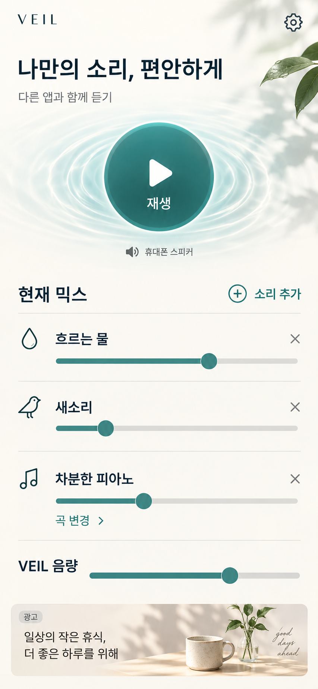
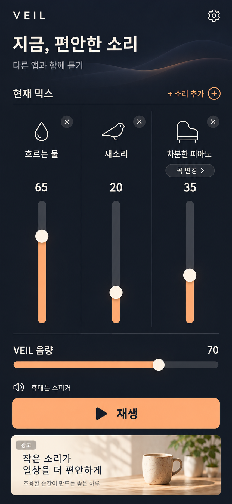
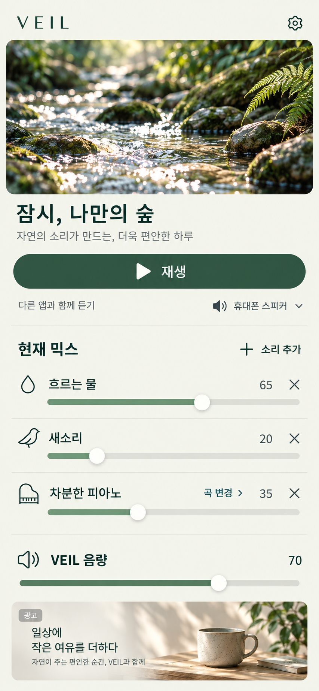

# VEIL 추가 믹서 시안

작성일: 2026-10-12 · 날짜 기준: Asia/Seoul · 범위: 모바일 메인 믹서의 디자인 탐색

기존 시안을 확인하지 못했다는 사용자 피드백에 따라 새 시안 3종을 제작하고 대화에 직접 표시했습니다. 아래 번호는 **이번에 추가 생성한 이미지가 대화에 표시된 순서**와 일치합니다. 기존 시안의 번호와 구분합니다.

이미지는 디자인 검토용 정적 시안입니다. 앱 화면을 구현하거나 오디오·광고 동작을 검증한 결과가 아닙니다. 기준 디자인 결정은 [사용자 결정 항목](../OWNER_ACTIONS.md)의 `DESIGN-001`에서 관리합니다.

## 비교 기준

| 번호 | 방향 | 중심 구성 |
| ---: | --- | --- |
| 1 | Pure Ease | 큰 원형 재생 버튼, 밝은 화면, 가로 음량 슬라이더 |
| 2 | Studio Mix | 어두운 화면, 세로 페이더 3개, 하단 재생 버튼 |
| 3 | Forest Window | 자연 풍경 이미지, 가로 믹서, 분리된 광고 영역 |

공통 설계 기준은 물소리·새소리·피아노 혼합, 개별 음량, `VEIL 음량`, 소리 추가, 피아노 곡 변경, 다른 앱과 함께 듣는 흐름입니다. 백색소음 등 다른 소리는 `소리 추가`를 통해 선택하는 범위이며, 현재 믹스에는 세 가지 예시만 표시했습니다.

## 시안 1

## 시안 2

## 시안 3

## 구현 전 확인 사항

- 목표 논리 화면은 `390 × 844`입니다. 생성 이미지의 크기는 파일 원본을 따르며, 실제 기기의 안전 영역·화면 크기·글자 확대 대응은 구현 단계에서 확인합니다.
- `VEIL 음량`은 앱 내부 믹서 출력만 조절합니다. 이미지의 `다른 앱과 함께 듣기` 문구는 제품 의도를 나타내며, 동시 재생 검증을 통과했다는 표시가 아닙니다.
- 슬라이더의 시각적 위치는 시안 표현입니다. 실제 수치·음량 곡선·접근성 값·터치 영역은 구현 시 정확하게 정의합니다. 시안 1은 숫자 음량 표기를 생략한 표현입니다.
- 시안 3의 출력 장치 옆 화살표는 디자인 제안입니다. 출력 장치 선택 제공 여부와 플랫폼별 동작은 아직 확정하지 않았습니다.
- 광고 이미지와 문구는 배치 예시입니다. 광고 SDK가 재생과 다른 앱의 오디오에 미치는 영향은 별도 실기기 검증 대상입니다.

## 다음 할 사항

| 번호 | 다음 할 사항 | 완료 기준 |
| ---: | --- | --- |
| 1 | 기준 시안 선택 또는 수정 방향 지정 | `DESIGN-001`에 결정 기록 |
| 2 | 소리 추가·곡 변경·정지 상태 상세화 | 선택된 방향을 기준으로 후속 화면 정의 |
| 3 | Android·iPhone 동시 재생 실험 | [오디오 검증 시나리오](../audio-coexistence.md)의 실행 결과 기록 |
