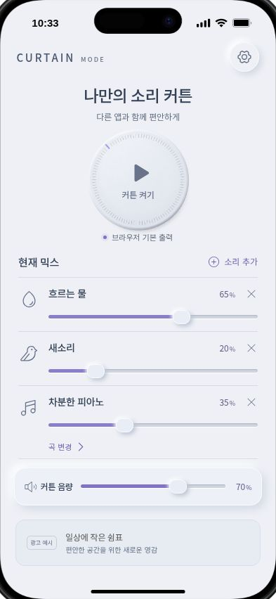
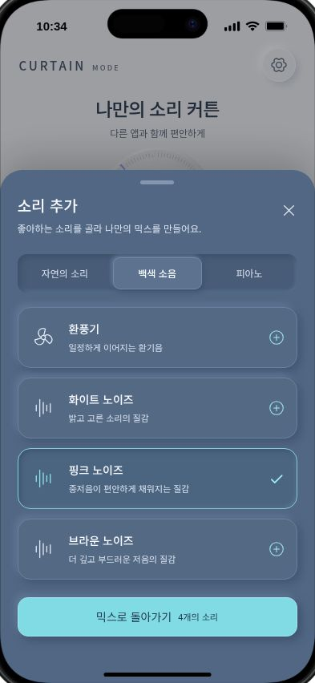
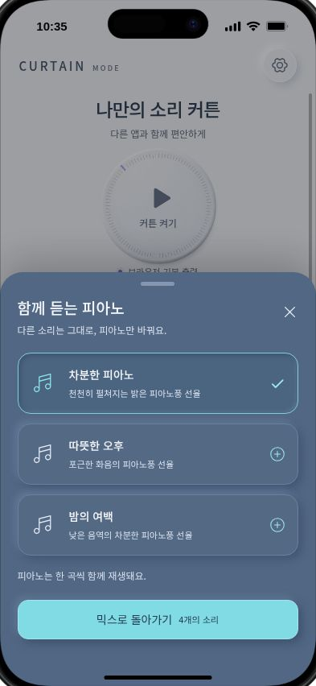

# 앱 이름 제안과 최신 스크린샷

- 작성: 2026-10-12, Asia/Seoul
- 사용자 요청: 커튼 개념의 앱 이름 제안, 현재 구현 화면 스크린샷
- 제안 1순위: **쉿커튼**
- 현재 화면 표시명: **커튼모드 / CURTAIN MODE** — 가칭. 사용자 최종 선택은 아직 없다.

## 이름 후보

| 번호 | 후보 | 전달하는 의미 | 판단 |
| --- | --- | --- | --- |
| 1 | **쉿커튼** | 사적인 순간을 소리로 가려주는 작은 커튼 | 짧고 기억하기 쉬우며 매너 앱이라는 역할을 가장 빠르게 전달한다. 이름의 친근한 어감을 차분한 펄그레이·블루그레이 화면이 받쳐 준다. |
| 2 | **살랑커튼** | 물소리·바람·피아노가 만드는 부드러운 공간 | 현재 색감·입체적인 재질과 잘 어울린다. 자연음·휴식으로 확장하기 좋지만 소리 가림 기능은 설명 문구로 보완해야 한다. |
| 3 | **소곤커튼** | 조용하고 사적인 나만의 소리 공간 | 부드럽고 친근하다. 말소리나 속삭임 서비스로 오해하지 않도록 환경음 믹서라는 설명을 함께 쓴다. |

이 표는 브랜드 표현에 대한 제안이다. 사용자가 이름을 선택한 기록이나 이름의 사용 가능성·상표 등록 가능성을 확인한 결과가 아니다.

## 추천 조합

- 앱 이름: **쉿커튼**
- 설명 문구: **물소리와 음악으로 만드는 나만의 소리 커튼**
- 대표 문구: **소리를 켜고, 마음은 편하게.**

화장실 용도를 이름에 직접 넣지 않으면서 매너 제품이라는 의도를 전한다. 효과를 완전한 차음이나 ANC로 설명하지 않는다. 영문 표기는 최종 한글 이름 선택 후 정한다.

## 선행 사용 확인

2026-10-12 공개 페이지에서 아래 사례를 확인했다. 이 확인은 상표 조사 전체를 대신하지 않는다. 후보 이름에 검색 결과가 적다는 이유로 미사용 이름이라고 단정하지 않는다.

| 이름 | 확인한 사례 | 제안에 반영한 판단 |
| --- | --- | --- |
| Sound Curtain | [Google Play의 Focus & Relax Sound Curtain](https://play.google.com/store/apps/details?id=com.citybell.curtain)은 자연음·백색소음 혼합 앱이다. | 동종 앱과 비슷하므로 사운드커튼을 최우선 브랜드 후보로 제안하지 않는다. |
| 커튼온 | [App Store의 커튼온](https://apps.apple.com/kr/app/%EC%BB%A4%ED%8A%BC%EC%98%A8/id6798960402)은 공연 커뮤니티 앱이다. | 기존 앱명과 같은 후보는 제외했다. |
| 커튼모드 | [삼성전자 세리프 TV 공식 소개](https://news.samsung.com/kr/%EC%82%BC%EC%84%B1%EC%A0%84%EC%9E%90-%EC%84%B8%EB%A6%AC%ED%94%84-tv-%EA%B5%AD%EB%82%B4-%EC%B6%9C%EC%8B%9C)에 UI 명칭으로 사용된 사례가 있다. | 현재 시안의 가칭으로 남기고 더 구별되는 후보를 제안한다. |

## 최신 실제 화면

캡처 시간: 2026-10-12 10:33~10:35 KST. 코드나 화면의 표시명을 바꾸지 않고 현재 브라우저 미리보기에서 촬영했다. 세 파일 모두 393 × 852px JPG이며, iPhone 화면 393 × 852 CSS px / DPR 1 / scale 1을 확인했다. 실제 iPhone 설치 화면이나 스토어 출시 화면은 아니다.

### 홈

기본 환경음 2개와 피아노 1개, 개별 음량과 커튼 음량, 광고 예시를 표시한다.

### 소리 선택

백색 소음 탭에서 핑크 노이즈를 선택해 총 4개 소리가 된 상태다.

### 피아노 선택

환경음을 유지하면서 피아노 1곡을 선택하는 화면이다.

## 다음 할 사항

| 번호 | 다음 할 사항 | 완료 기준 |
| --- | --- | --- |
| 1 | 앱 이름 후보 선택 | 사용자 결정 후 가칭을 최종 후보로 교체 |
| 2 | 이름의 스토어·상표·영문 표기 확인 | 출시용 이름과 표시 체계 확정 |
| 3 | 선택한 이름의 워드마크와 앱 아이콘 적용 | 홈·설정·설치 표시명 일치 |
| 4 | Android·iPhone 실기기 검증 | YouTube 동시 재생·잠금·출력 변경 결과 기록 |
